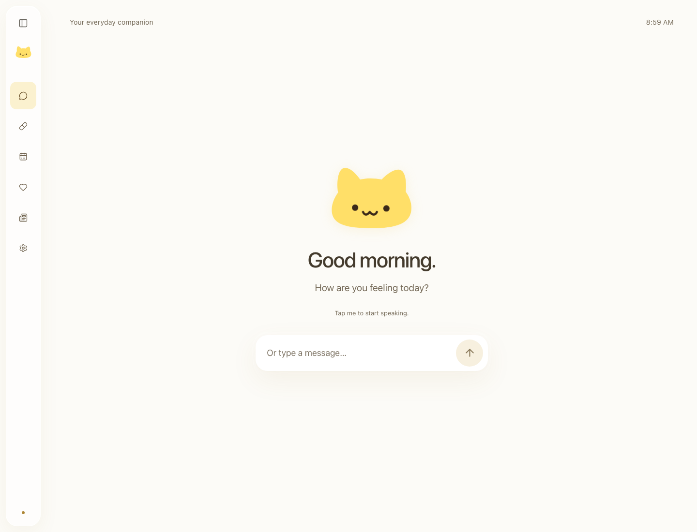

# Dayla

**A little company, every day.**

Dayla is an English voice companion for everyday routines. A quiet home screen greets you according to the time of day, with one place to speak or type and a small animated companion. Medication check-ins, schedules, family drafts, news and settings live in the sidebar.

Built for an awake PC with a local server. The conversation engine supports a bounded set of everyday requests; it is not a general-purpose language model. Medication responses are self-reports and require confirmation before saving.



## Run locally

Use Node.js **22 LTS, 22.12 or newer** and npm. SQLite uses a native module; use a supported Node 22 release if installation fails.

```sh
npm ci
npm run build
npm start
```

Open **http://127.0.0.1:3001**. For hot reload, run `npm run dev` and open http://127.0.0.1:5173. Stop with Ctrl+C.

Typing, schedules, local records and family drafts work without an API key. Cline is an optional development tool, not an application dependency; see [the handoff](docs/CLINE_TASK.md).

## Connect a voice

Copy `.env.example` to `.env` and fill in one of these server-only configurations using an existing account. Restart the server after changing it. Never put credentials in client code or commit `.env`.

| Route                                  | Variables                                            |
| -------------------------------------- | ---------------------------------------------------- |
| ElevenLabs through Composio, preferred | `COMPOSIO_API_KEY`, `COMPOSIO_ELEVENLABS_ACCOUNT_ID` |
| ElevenLabs directly                    | `ELEVENLABS_API_KEY`                                 |
| Voice selection for either route       | `ELEVENLABS_VOICE_ID`                                |

The Composio account ID must identify your connected **ElevenLabs** account. When both Composio values are present, that route takes priority. A provider failure is reported rather than silently switching accounts. `ELEVENLABS_VOICE_ID` defaults to the voice in `.env.example`.

Press the microphone to start a short recording, then press it again to finish. Audio is transcribed into English, passed to Dayla's conversation rules, and answered with synthesized speech. The character responds to the measured microphone and cloud playback audio level. Recordings are handled in memory and are not written to the local database.

If cloud voice is not configured, Dayla offers browser speech **only after an explicit choice**. Browser recognition may send audio to the browser vendor's service; it is not an offline promise. Browser speech output uses available voices reported as local and English. Its character animation follows speaking state because the browser does not expose that voice's audio waveform. Unsupported recognition or missing voices leave typing available.

Configuration status means credentials are present, not that an account or paid request has been verified. Live Composio/ElevenLabs success must be checked with the configured presentation device; see [verification status](docs/ACCEPTANCE.md).

## One conversation, a few useful actions

- Ask **“What time is it?”** or **“What is on my schedule?”**.
- Say **“I took my medication”**, **“Not yet”**, or **“I am not sure”** for a due check-in. Dayla asks for confirmation; only **“Yes”** or **Confirm** saves the response.
- Open Medication to review or correct a self-report. Corrections retain history.
- Open Schedule for the planned visit, or Family to create a local message draft. No message is sent.
- News retrieves up to three attributed English BBC News headlines with links and freshness information.

Hourly check-ins require a running server, a foreground page and enabled voice. Missed announcements are not replayed after reconnect or restart. Sleep, screen lock and closed tabs are outside the delivery guarantee.

The default clock follows current time. Presentation controls are available only with `?presenter=1`; the separate [presenter guide](docs/DEMO.md) explains the repeatable morning flow. They do not change the computer's clock.

## Structure

```text
src/
  client/
    App.tsx             # navigation, conversation and foreground cue lifecycle
    components/Brand.tsx # original SVG mark and animated companion
    components.tsx      # shared headings and confirmation dialog
    features/           # medication, visits, family, news and settings
    lib/                # HTTP client and voice lifecycle
    styles.css          # responsive visual system
  server/
    domain/             # time and validation rules
    http/               # localhost API and request validation
    services/           # conversation rules, cloud voice and bounded RSS
    storage/            # SQLite schema, transactions, clock and records
    index.ts            # environment, server and scheduler lifecycle
  shared/contracts.ts   # transport types, no server imports in the client
tests/                  # domain, API, voice and browser tests
docs/                   # design, presenter guide, provenance and Cline handoff
var/                    # local SQLite files, ignored by Git
```

One package and lockfile keep setup small. React + Vite provide the UI; Express + Zod validate requests; SQLite persists responses and correction history. `node-cron` advances the live clock and expires announcements. Provider adapters use server-side HTTP without adding a runtime agent framework.

## Verification

```sh
npm run format:check
npm run lint
npm run typecheck
npm test
npm run build
npx playwright install chromium
npm run test:e2e
```

Browser tests use a separate server on port 3101 and `var/e2e.sqlite`. They require loopback access. See [acceptance evidence and device checks](docs/ACCEPTANCE.md); mocked speech tests do not prove actual microphone quality or provider connectivity.

## Data and scope

Seeded medication labels and schedules are fictional. Database writes are real. Response timestamps use the actual PC clock, including during the controlled presentation flow. `DAYLA_DB_PATH` selects the local database; its default is `var/dayla.sqlite`. `PORT` defaults to 3001. The server binds to `127.0.0.1` only.

This is a hackathon prototype, not a medical device or production care service. It does not verify doses or visits, prescribe actions, send family messages, or promise background delivery. Local storage is not encrypted. Cloud speech sends audio or response text to the configured services. Do not use sensitive personal data for a presentation.

## Open source

Dayla is [MIT licensed](LICENSE). The original sidebar and card layout adapted the user-selected [Project-1](https://github.com/Atharvsinh-codez/Project-1); the current home uses an animated SVG cat based on the user-provided character reference, shared with the logo and favicon, on a flat warm-white canvas. Upstream images, branding and fonts are not copied. See [third-party notices](THIRD_PARTY_NOTICES.md) for provenance, the upstream license discrepancy, and dependency notices.

Contributions: [CONTRIBUTING.md](CONTRIBUTING.md). Security boundary: [SECURITY.md](SECURITY.md).
